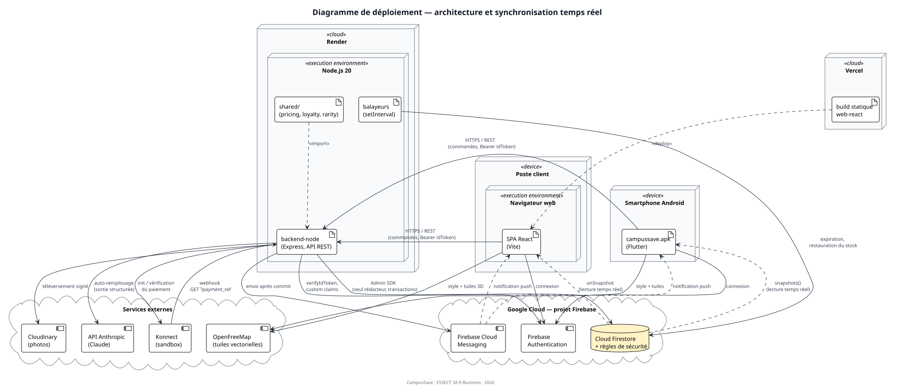
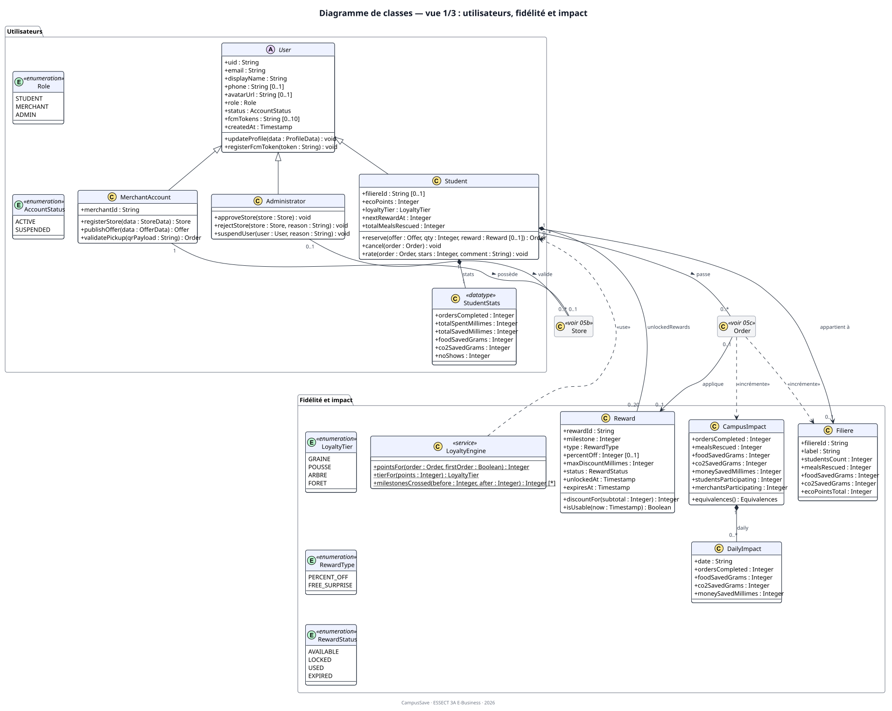
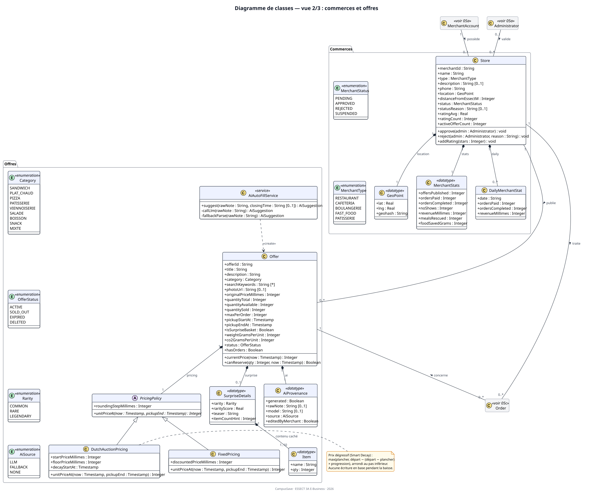
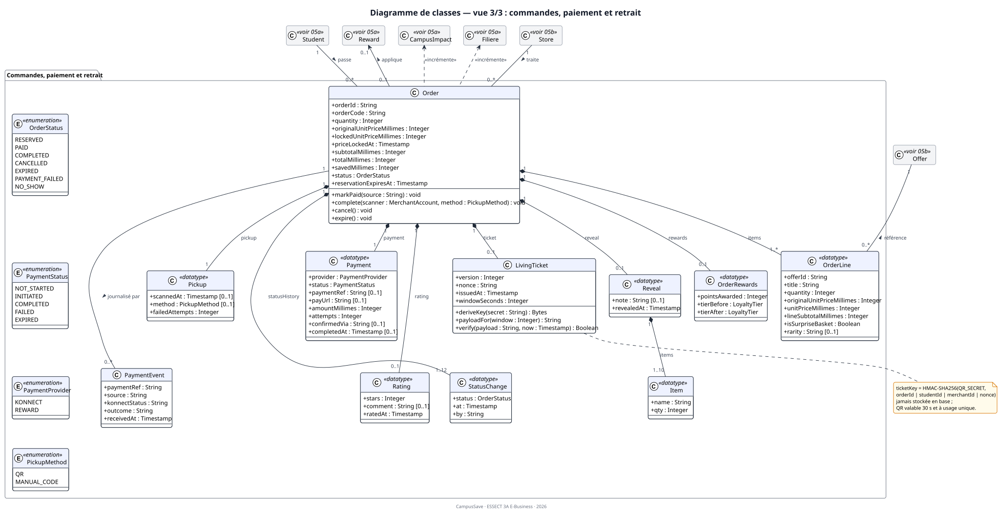
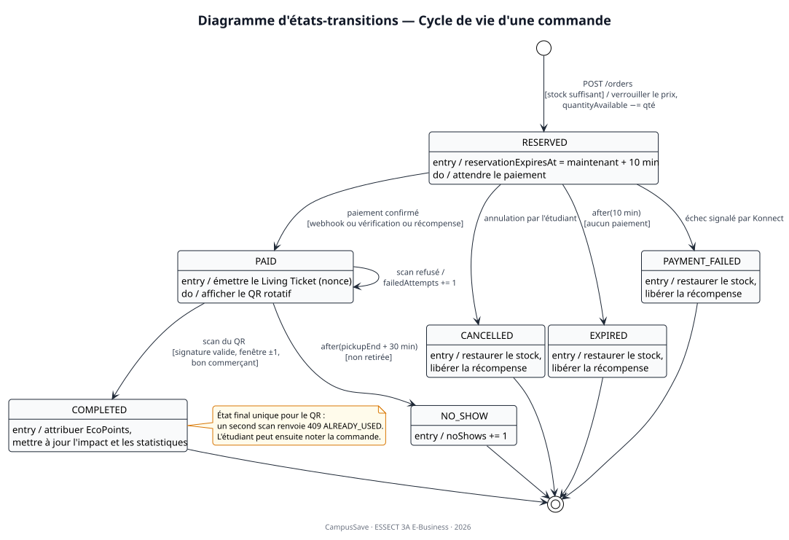
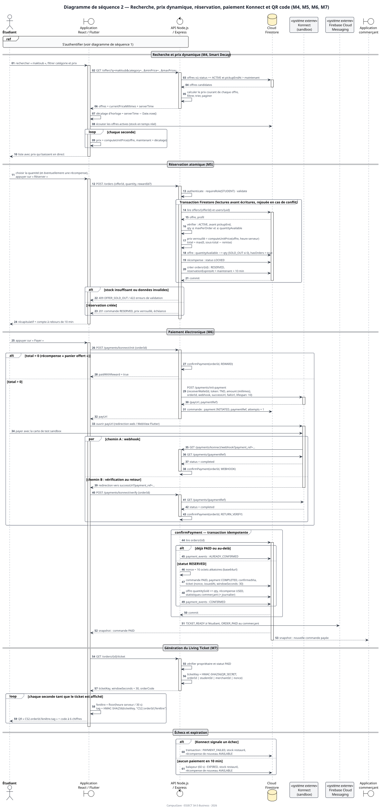
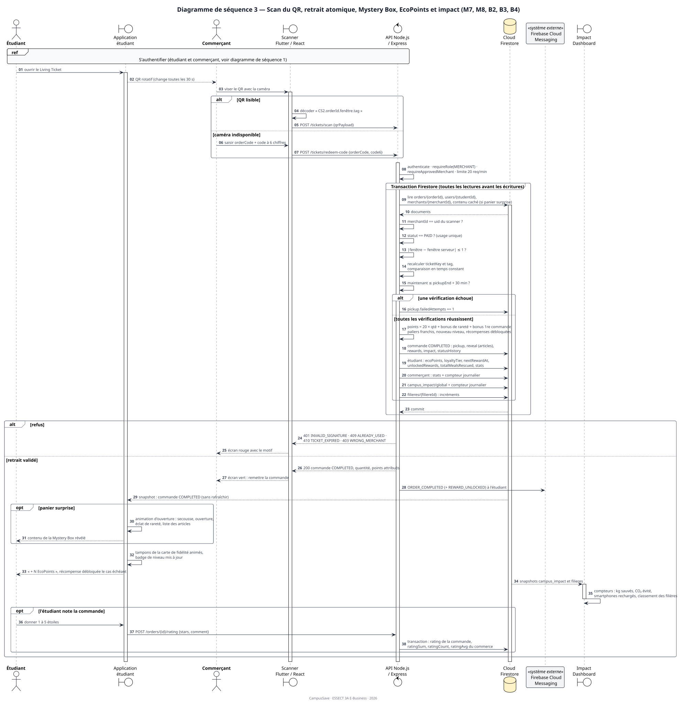

# CHAPITRES TECHNIQUES DE SYNTHÈSE (III, IV, V & VII)
## PROJET PÉDAGOGIQUE INTÉGRATEUR — CAMPUSSAVE (ESSECT MONTFLEURY 2026)

> **Auteur des chapitres techniques :** Fedi TOUATI (Lead Backend, Sécurité & Architecture)  
> **Binôme :** Ritej BEJAOUI (Lead UI/UX & Frontend)  
> **Filière :** 3ème Année Licence en Sciences Économiques et de Gestion — Mention E-Business  
> **Établissement :** École Supérieure des Sciences Économiques et Commerciales de Tunis (ESSECT)  
> **Année Universitaire :** 2026-2027  

---

## 🏛️ CHAPITRE III — ARCHITECTURE LOGIQUE, PHYSIQUE ET CHOIX TECHNOLOGIQUES

### 3.1 Justification de l'Architecture Omnicanale 3-Tiers Partagée

La conception d'une plateforme anti-gaspillage en environnement universitaire soulève des défis d'ingénierie logicielle singuliers :
1. **Hétérogénéité des terminaux :** Les étudiants alternent constamment entre leur ordinateur portable en salle de cours ou bibliothèque (accès Web) et leur smartphone lors de leurs déplacements entre les amphis et les restaurants de Montfleury (accès Mobile).
2. **Contraintes des commerçants :** Les restaurateurs et boulangers disposent rarement d'un terminal dédié ; ils utilisent soit la tablette de caisse (navigateur Web), soit leur smartphone personnel pour flasher les commandes au comptoir (application Mobile).
3. **Immutabilité des règles financières et sanitaires :** La gestion des stocks, la tarification dynamique et la validation des paiements ne doivent tolérer aucune divergence de calcul entre les canaux.

Pour satisfaire ces exigences sans duplication de code, nous avons retenu une **architecture 3-tiers découplée centrée sur une API REST unifiée** :

```text
┌──────────────────────────────────────┐     ┌──────────────────────────────────────┐
│          CLIENT WEB REACT 18         │     │        CLIENT MOBILE FLUTTER 3       │
│  Vite, Tailwind CSS, MapLibre WebGL  │     │   Dart 3, Provider, Mobile Scanner   │
└──────────────────┬───────────────────┘     └──────────────────┬───────────────────┘
                   │                                            │
                   │ (Lectures temps réel onSnapshot / Stream)  │
                   ▼                                            ▼
         ┌─────────────────────────────────────────────────────────────┐
         │             GOOGLE CLOUD FIRESTORE (NoSQL)                  │
         │           Base réactive dénormalisée multi-région           │
         └─────────────────────────────▲───────────────────────────────┘
                                       │
                                       │ (Mutations transactionnelles sécurisées)
                                       │
         ┌─────────────────────────────┴───────────────────────────────┐
         │          API REST TRANSACTIONNELLE NODE.JS 20 / EXPRESS     │
         │      Firebase Admin SDK, Zod Validation, Crypto HMAC        │
         └─────────────────────────────▲───────────────────────────────┘
                                       │
              ┌────────────────────────┴────────────────────────┐
              ▼                                                 ▼
┌───────────────────────────┐                     ┌───────────────────────────┐
│     KONNECT NETWORK       │                     │    CLOUDINARY & GEMINI    │
│ Passerelle Paiement Dinar │                     │  CDN Médias & Modèle LLM  │
└───────────────────────────┘                     └───────────────────────────┘
```

#### Comparatif et Justification des Choix Technologiques

| Composant | Technologie Retenue | Alternatives Évaluées | Justification Décisive pour CampusSave |
| :--- | :--- | :--- | :--- |
| **Backend REST** | **Node.js 20 (LTS) & Express** | Python / Django, PHP / Laravel | Modèle asynchrone non bloquant ultra-performant pour les E/S ; écosystème NPM mature avec le SDK officiel `firebase-admin` ; partage naturel du code JavaScript avec le frontend Web. |
| **Frontend Web** | **React.js 18 & Vite** | Angular, Vue.js 3 | Virtual DOM réactif, écosystème de composants riche (Recharts, Lucide, Canvas WebGL), compilation ultra-rapide sous Vite (< 15s) et intégration fluide des hooks temps réel Firebase. |
| **Frontend Mobile** | **Flutter 3.x (Dart 3)** | React Native, Kotlin natif | Moteur de rendu graphique Skia/Impeller compilé en code machine natif 60 fps ; accès direct aux périphériques caméra et haptiques pour le scanner QR ; typage strict éliminant les bugs d'exécution. |
| **Base de Données** | **Google Cloud Firestore** | PostgreSQL, MongoDB | Architecture NoSQL distribuée nativement temps réel ; capacités d'abonnements réactifs (`onSnapshot`) idéales pour les catalogues et les tickets de retrait ; scalabilité automatique sans gestion de serveur. |
| **Sécurité & Validation** | **Zod v3 & Crypto natif** | Joi, Yup, bcrypt | Inférence statique TypeScript/JavaScript avec validation à l'exécution ; cryptographie HMAC-SHA256 intégrée sans dépendance externe vulnérable. |

---

### 3.2 Le Pattern CQRS-lite : Écritures REST vs Lectures Réactives Firestore

Pour concilier la réactivité instantanée du Web modernisé et l'intégrité absolue des transactions financières, CampusSave implémente un pattern architectural de ségrégation des responsabilités de lecture et d'écriture (**CQRS-lite** — *Command Query Responsibility Segregation*) :

```text
   FLUX DE COMMANDE (ÉCRITURE SÉCURISÉE)          FLUX DE CONSULTATION (LECTURE TEMPS RÉEL)
   ════════════════════════════════════          ═════════════════════════════════════════

[ Client Web / Flutter ]                       [ Client Web / Flutter ]
         │                                              │
         │ 1. POST /orders                              │ 1. Abonnements onSnapshot()
         ▼                                              ▼
┌──────────────────────────────────┐           ┌──────────────────────────────────┐
│ API REST Node.js (Firebase Admin)│           │      Google Cloud Firestore      │
│  - Contrôle des rôles            │           │   - Offres actives               │
│  - Validation Zod du schéma      │           │   - Suivi direct de commande     │
│  - Transaction atomique db.runTx │           │   - Notifications en direct      │
└────────────────┬─────────────────┘           └──────────────────────────────────┘
                 │                                      ▲
                 │ 2. Écriture atomique validée         │ Flux de mise à jour instantané
                 └──────────────────────────────────────┘
```

1. **Canal des Commandes (Écritures strictes via l'API REST) :**
   * **Aucun droit d'écriture direct :** Les applications Web et Mobile ne disposent d'aucun droit d'écriture direct sur Firestore (`allow write: if false;` dans `firestore.rules`).
   * **Validation préalable :** Chaque requête entrante franchit un pipeline strict de middlewares : authentification JWT Firebase, vérification des rôles (`STUDENT`, `MERCHANT`, `ADMIN`), et validation des schémas de données par la bibliothèque **Zod**.
   * **Atomicité garantie :** Toutes les opérations touchant au stock, aux réservations, aux paiements et à la validation des tickets s'exécutent dans une transaction Firestore unifiée (`db.runTransaction()`). Si deux étudiants cliquent sur le dernier repas à la même milliseconde, la concurrence optimiste de Firestore garantit qu'un seul remporte la réservation tandis que l'autre reçoit un code d'erreur explicite `409 CONFLICT`.

2. **Canal des Requêtes (Lectures réactives synchronisées) :**
   * Les clients Web et Mobile s'abonnent directement aux collections autorisées (`offers`, `orders`, `merchants`) via les écouteurs natifs de Firestore (`onSnapshot()` en JavaScript, `StreamSubscription` et `snapshots()` en Dart).
   * Dès que l'API REST modifie l'état d'une commande (de `RESERVED` à `PAID`), l'écran du client bascule instantanément vers l'état payé sans aucun sondage HTTP (*polling*), réduisant drastiquement la consommation de bande passante et la latence perçue.

---

### 3.3 Module Métier & Mathématique Partagé (`/shared`)

Un écueil classique des projets omnicanaux réside dans la dérive des calculs métier entre l'application web et l'application mobile. Pour prémunir CampusSave contre ce risque, l'ensemble des constantes, algorithmes d'arrondi et règles écologiques sont centralisés dans le répertoire racine `/shared` :

* **Arithmétique monétaire (`shared/money.js`) :** Manipulation exclusive d'entiers en millimes tunisiens (1 TND = 1000 millimes) pour éliminer les erreurs d'imprécision inhérentes aux nombres flottants IEEE 754.
* **Moteur d'enchère temporelle (`shared/pricing.js`) :** Fonction pure `computeUnitPrice(offer, nowMs)` garantissant que le prix affiché sur le catalogue Web, calculé sur le mobile Flutter ou validé par le serveur Node.js est rigoureusement identique à la seconde près.
* **Programme de fidélité végétal (`shared/loyalty.js`) :** Règles d'attribution des 4 grades (`GRAINE`, `POUSSE`, `ARBRE`, `FORET`) et tampons de récompense.
* **Équivalences carbone certifiées (`shared/impact.js`) :** Ratios officiels de conversion écologique (2.5 g CO₂e par gramme d'aliment sauvé).

---

### 3.4 Diagramme Physique de Déploiement Cloud

Le déploiement de CampusSave repose sur des infrastructures Cloud résilientes et distribuées :



* **Couche Client :**
  * L'application Web React est compilée en actifs statiques optimisés (`dist/`) hébergés sur le réseau de distribution de contenu (**Vercel CDN**) avec routage SPA universel via `vercel.json`.
  * L'application Mobile Flutter est compilée en binaire natif Android (`app-release.apk`) intégrant le moteur graphique Impeller.
* **Couche Backend :**
  * L'API REST Node.js est déployée dans un conteneur sécurisé sur la plateforme **Render** (Node.js 20 LTS) derrière un proxy inverse HTTPS avec chiffrement TLS 1.3.
  * Pour la soutenance universitaire, un tunnel chiffré **Cloudflare Tunnel / ngrok** relie le serveur de démonstration local aux terminaux mobiles physiques et aux webhooks de la passerelle de paiement.
* **Services Cloud Tiers :**
  * **Google Cloud Platform (Firebase) :** Authentification OAuth2 / Identifiants, Base NoSQL Firestore multi-région, et Firebase Cloud Messaging (FCM) pour les notifications push en temps réel.
  * **Konnect Network :** Passerelle de paiement tunisienne gérant les transactions en Dinars par cartes bancaires (GIE Cartes Bancaires) et portefeuilles électroniques.
  * **Cloudinary CDN :** Téléversement, redimensionnement et optimisation automatique au format WebP des photographies de plats prises par les commerçants.

---

## 📐 CHAPITRE IV — CONCEPTION DÉTAILLÉE, MODÉLISATION UML ET SCHÉMA NoSQL

### 4.1 Modélisation Statique par Diagrammes de Classes UML

La modélisation orientée objet de CampusSave est découpée en trois sous-domaines métier cohérents pour préserver la clarté conceptuelle :

#### 1. Domaine des Utilisateurs, Rôles et Fidélité (`05a-classes-utilisateurs.svg`)
Ce domaine encapsule la hiérarchie des acteurs et le portefeuille écologique de l'étudiant :



* **Classe `User` :** Entité de base rattachée au compte Firebase Auth (`uid`), caractérisée par son adresse email, son rôle (`STUDENT`, `MERCHANT`, `ADMIN`) et son état d'activation (`ACTIVE`, `SUSPENDED`).
* **Classe `StudentProfile` :** Extension du profil étudiant rattachée à l'une des 5 filières de l'ESSECT (`EBUSINESS_3A`, `FINANCE`, `MARKETING`, `GESTION`, `COMPTABILITE`). Elle agrège le solde d'**EcoPoints**, le niveau de fidélité actuel (`LoyaltyTier`), l'historique des bons débloqués (`RewardCoupon`) et les compteurs d'impact personnel (`mealsRescued`, `co2SavedGrams`).
* **Classe `MerchantProfile` :** Représente l'identité commerciale de l'établissement partenaire, incluant sa raison sociale, son adresse physique géocodée (`GeoLocation`), son numéro de téléphone professionnel et son statut de modération (`PENDING`, `APPROVED`, `REJECTED`, `SUSPENDED`).

#### 2. Domaine des Commerces, Offres et Paniers Surprises (`05b-classes-commerces-offres.svg`)
Ce domaine structure la publication des invendus alimentaires et la mécanique de tarification :



* **Classe `Offer` :** Représente l'annonce anti-gaspillage. Elle associe un libellé, une description, une catégorie culinaire (`OfferCategory`), une image hébergée sur Cloudinary, un créneau de retrait (`pickupStartAt`, `pickupEndAt`) et un stock disponible décrémenté atomiquement.
* **Hiérarchie de Tarification (`PricingStrategy`) :** 
  * `FixedPricing` : Prix remisé statique défini dès la publication.
  * `DutchAuctionPricing` : Tarification dynamique paramétrée par un prix de départ (`initialPriceMillimes`), un prix plancher minimal (`floorPriceMillimes`), une heure d'activation de la décroissance (`decayStartAt`) et un pas d'arrondi (`stepMillimes`).
* **Extension `SurpriseBasket` :** Modélise les paniers mystères caractérisés par leur niveau de rareté (`COMMON`, `RARE`, `LEGENDARY`), leur bonus d'EcoPoints à la révélation, et leur liste confidentielle d'articles scellée jusqu'au scan physique.

#### 3. Domaine des Commandes, Transactions et Retrait (`05c-classes-commandes.svg`)
Ce domaine régit l'engagement contractuel, le flux monétaire et la preuve de délivrance :



* **Classe `Order` :** Contrat liant l'étudiant acquéreur, le commerçant vendeur et l'offre réservée. Elle consigne le prix unitaire scellé lors de la réservation (`lockedUnitPriceMillimes`), le code lisible en base 32 Crockford (`orderCode`), le compte à rebours d'expiration de 10 minutes (`reservationExpiresAt`) et le secret cryptographique (`ticketNonce`).
* **Classe `PaymentTransaction` :** Traçabilité du paiement Konnect, enregistrant l'identifiant distant (`paymentRef`), l'URL de redirection sécurisée, le statut d'encaissement et l'empreinte d'idempotence.
* **Classe `LivingTicket` :** Entité de contrôle générant le code QR dynamique rotatif et stockant le compteur de tentatives de scan infructueuses (`failedAttempts`).

---

### 4.2 Machine à États Finis du Cycle de Vie des Commandes

Le traitement d'une réservation anti-gaspillage obéit à un automate d'états finis déterministe (Diagramme UML 09), interdisant toute transition illicite ou retour arrière non autorisé :



```text
                  ┌────────────────────────────────────────────────────────┐
                  │                        PANIER                          │
                  └───────────────────────────┬────────────────────────────┘
                                              │ POST /api/v1/orders
                                              ▼
                  ┌────────────────────────────────────────────────────────┐
                  │                       RESERVED                         │
                  │        (Stock décrémenté, horloge 10 minutes)          │
                  └─────────────┬────────────────────────────┬─────────────┘
                                │                            │
          Paiement réussi       │                            │ Expiration 10 min ou
     (Webhook / Verify Konnect) │                            │ Annulation volontaire
                                ▼                            ▼
┌──────────────────────────────────────────────┐   ┌────────────────────────────────┐
│                     PAID                     │   │           CANCELLED            │
│  (Living Ticket activé, QR rotatif 30s)      │   │ (Stock restitué à l'inventaire)│
└───────────────────────┬──────────────────────┘   └────────────────────────────────┘
                        │
                        │ Scan QR comptoir ou saisie code 6 chiffres
                        ▼
┌──────────────────────────────────────────────┐
│                  COMPLETED                   │
│   (Repas remis, EcoPoints crédités,          │
│    contenu panier surprise révélé)           │
└───────────────────────┬──────────────────────┘
                        │
                        │ Évaluation volontaire (1 à 5 étoiles)
                        ▼
┌──────────────────────────────────────────────┐
│                    RATED                     │
│    (Note moyenne commerçant recalculée)      │
└──────────────────────────────────────────────┘
```

#### Matrice Formelle des Transitions d'États

| État Initial | Événement Déclencheur | État Cible | Conditions & Actions Transactionnelles Associées |
| :--- | :--- | :--- | :--- |
| *Création* | `POST /orders` | `RESERVED` | Le stock de l'offre est $> 0$. Le stock est décrémenté de 1. L'horloge de réservation est fixée à $T_{now} + 10\text{ min}$. Le prix unitaire est scellé. |
| `RESERVED` | Paiement Konnect validé | `PAID` | Le paiement est vérifié via webhook ou redirection. `ticketNonce` cryptographique est initialisé. Les notifications push commerçant sont envoyées. |
| `RESERVED` | Expiration (10 min) ou `POST /orders/:id/cancel` | `CANCELLED` | L'étudiant annule ou l'horloge expire. Le stock de l'offre est restitué de $+1$ dans Firestore. |
| `PAID` | Scan QR validé (`POST /tickets/validate`) | `COMPLETED` | La signature HMAC-SHA256 est validée. Le ticket est marqué consommé. Les EcoPoints sont crédités à l'étudiant. Le contenu secret du panier surprise est déverrouillé. |
| `PAID` | Expiration créneau $+30$ min sans scan | `NO_SHOW` | Le robot `noShowSweeper` clôture la commande. Aucun remboursement ; compteurs de non-présentation incrémentés. |
| `COMPLETED` | `POST /orders/:id/rating` | `RATED` | L'étudiant attribue entre 1 et 5 étoiles. Mise à jour atomique de `ratingAvg`, `ratingSum` et `ratingCount` du commerce. |

---

### 4.3 Diagrammes de Séquence de Référence

#### 1. Réservation Atomique, Paiement Konnect et Génération du Ticket (`07-seq-reservation-paiement-qr.svg`)
Ce diagramme détaille la coordination entre l'étudiant, l'API REST CampusSave, Firestore et la passerelle bancaire Konnect :



1. L'étudiant sélectionne une offre et transmet une requête `POST /orders`.
2. L'API Node.js ouvre une transaction Firestore `db.runTransaction` :
   * Elle lit le stock courant de l'offre. Si $stock \le 0$, rejet immédiat `409 CONFLICT`.
   * Elle évalue le prix exact à l'instant de réception via `computeUnitPrice()`.
   * Elle décrémente le stock de 1 et crée le document `orders/{id}` à l'état `RESERVED`.
3. L'étudiant sollicite `POST /payments/initiate`. Le serveur contacte l'API Konnect Sandbox et retourne l'URL de paiement bancaire (`payUrl`).
4. L'étudiant valide son paiement sur l'interface sécurisée de Konnect.
5. Konnect expédie un webhook asynchrone `POST /payments/webhook` signé. Le serveur passe la commande à `PAID` et initialise le secret cryptographique du Living Ticket.

#### 2. Validation au Comptoir par Scan QR et Attribution des ÉcoPoints (`08-seq-retrait-recompenses.svg`)
Ce diagramme illustre le protocole de délivrance physique au restaurant :



1. L'application de l'étudiant affiche le Living Ticket dont le code QR est régénéré dynamiquement toutes les 30 secondes à partir d'une signature HMAC.
2. Le commerçant scanne le code QR avec son smartphone via la caméra native gérée par Flutter (`MobileScanner`).
3. L'application commerçante transmet `POST /tickets/validate` avec le payload scanné `{ orderId, window, hash }`.
4. Le serveur valide la signature cryptographique en temps constant, vérifie que le commerçant connecté est bien le propriétaire de l'offre, et applique la transaction de clôture :
   * La commande passe à l'état `COMPLETED`.
   * Le profil étudiant reçoit $+20\text{ EcoPoints}$ (ou plus selon la rareté du panier surprise).
   * L'impact environnemental campus et filière est incrémenté.
   * L'application mobile du commerçant émet une vibration haptique de succès et l'écran de l'étudiant s'anime pour dévoiler le contenu de son panier.

---

### 4.4 Schéma NoSQL Dénormalisé et Règles de Sécurité Firestore

Pour satisfaire aux impératifs de performance en lecture tout en évitant les jointures complexes prohibées en NoSQL, le modèle de données applique une **dénormalisation contrôlée** avec instantanés de contexte :

#### Structure des Collections Principales

```text
campussave-firestore/
├── users/{uid}                         # Profils étudiants, commerçants et admin
├── merchants/{merchantId}              # Commerces partenaires géocodés
│   └── daily/{YYYY-MM-DD}              # Métriques journalières d'impact et de vente
├── offers/{offerId}                    # Offres alimentaires actives et archivées
│   └── private/contents                # Document confidentiel : contenu secret du panier
├── orders/{orderId}                    # Commandes transactionnelles et Living Tickets
├── campus_impact/global                # Indicateurs consolidés de l'ensemble du campus
│   └── daily/{YYYY-MM-DD}              # Historique sur 14 jours de l'impact collectif
└── filieres/{filiereId}                # Classement des 5 filières de l'ESSECT
```

#### Règles de Sécurité Granulaires (`firestore.rules`)

```javascript
rules_version = '2';
service cloud.firestore {
  match /databases/{database}/documents {

    // Fonctions d'assistance basées sur le jeton d'authentification Firebase Auth
    function isAuthenticated() {
      return request.auth != null;
    }
    function getUserRole() {
      return request.auth.token.role;
    }
    function isStudent() {
      return isAuthenticated() && (getUserRole() == 'STUDENT' || request.auth.token.email.matches('.*@essect.*'));
    }
    function isAdmin() {
      return isAuthenticated() && (getUserRole() == 'ADMIN' || request.auth.token.email == 'admin@campussave.tn');
    }

    // Interdiction universelle de toute mutation cliente directe (CQRS-lite)
    match /{document=**} {
      allow write: if false;
    }

    // Consultation publique des commerces approuvés
    match /merchants/{merchantId} {
      allow read: if true;
    }

    // Offres : lecture publique si approuvée, contenu privé scellé
    match /offers/{offerId} {
      allow read: if resource.data.status == 'ACTIVE' || isAdmin();
      
      // La sous-collection 'private' est inaccessible aux étudiants avant le scan
      match /private/{document=**} {
        allow read: if false;
      }
    }

    // Commandes : cloisonnement strict entre acheteur et vendeur
    match /orders/{orderId} {
      allow read: if isAuthenticated() && (
        resource.data.studentId == request.auth.uid || 
        resource.data.merchantId == request.auth.uid || 
        isAdmin()
      );
    }
  }
}
```

---

## ⚙️ CHAPITRE V — RÉALISATION TECHNIQUE, ALGORITHMES INTELLIGENTS ET SÉCURITÉ

### 5.1 Arithmétique Monétaire Entière et Parité Multi-Runtime

L'utilisation de nombres à virgule flottante (`Float` ou `Double`) pour des transactions financières constitue un anti-pattern notoire susceptible d'introduire des écarts d'arrondi incontrôlés (ex: `0.1 + 0.2 = 0.30000000000000004`). 

En Tunisie, la monnaie officielle est le Dinar Tunisien (TND), divisé en **1000 millimes**. CampusSave applique le principe strict de la **monnaie entière** :
* **Tous les prix en base de données et dans les payloads réseau sont des entiers représentant des millimes** (`lockedUnitPriceMillimes: 3800` pour 3,800 DT).
* La conversion en chaîne d'affichage monétaire est assurée par une fonction de formatage canonique partagée entre JavaScript et Dart :

$$\text{Format}(m) = \left\lfloor \frac{m}{1000} \right\rfloor + "," + \text{Pad3}(m \pmod{1000}) + " DT"$$

* Exemple : $3800 \pmod{1000} = 800 \implies \mathbf{3,800\text{ DT}}$.
* Exemple : $4050 \pmod{1000} = 50 \implies \mathbf{4,050\text{ DT}}$.

---

### 5.2 Moteur de Tarification Dynamique Dégressive (Smart Decay)

L'un des défis majeurs posés par le cahier des charges consiste à faire baisser le prix des invendus alimentaires au fur et à mesure que l'heure de fermeture du restaurant approche, simulant une **enchère hollandaise inversée (*Reverse Dutch Auction*)**, sans saturer la base de données de requêtes d'écriture répétées.

#### Formulation Mathématique de l'Algorithme

Soit une offre $O$ définie par son prix de départ $P_{init}$, son prix plancher $P_{floor}$, l'horodatage d'activation de la dégressivité $t_{start}$, l'horodatage de fin de retrait $t_{end}$, et un pas de discrétisation $\Delta = 100\text{ millimes}$.

Le prix unitaire exact à un instant d'observation quelconque $t$ est calculé par la fonction déterministe continue par morceaux :

$$P(t) = \begin{cases} 
P_{init} & \text{si } t < t_{start} \\
\max\left(P_{floor}, P_{floor} + \left\lfloor \frac{(P_{init} - P_{floor}) \times \left(1 - \frac{t - t_{start}}{t_{end} - t_{start}}\right)}{\Delta} \right\rfloor \times \Delta\right) & \text{si } t_{start} \le t < t_{end} \\
P_{floor} & \text{si } t \ge t_{end} 
\end{cases}$$

```text
  Prix (Millimes)
    ▲
5000│  P_init ────────┐
    │                 │ (Début de la dégressivité à t_start)
4000│                 └────┐
    │                      └────┐ (Paliers discrets de 100 millimes)
3000│                           └────┐
2000│                                └────┐
1500│                                     └────────── P_floor
    └───────────────────────────────────────────────────────────► Temps (t)
                       t_start                 t_end
```

#### Élimination Totale des Écritures Base de Données

1. **Calcul à la Volée côté Client :** Sur le Web React et le Mobile Flutter, des hooks dédiés (`useLivePrice` et `PriceTicker`) réévaluent l'expression toutes les secondes en mémoire locale. Le compteur de temps et le prix régressent de manière fluide sous les yeux de l'étudiant avec un indicateur visuel de tension (passage du vert au jaune puis à l'orange et au rouge clignotant).
2. **Scellage Atomique côté Serveur :** Le prix n'est matérialisé sous Firestore qu'une seule et unique fois, au moment précis où l'étudiant clique sur « Réserver ». L'API REST évalue la formule avec l'horloge officielle du serveur ($t = T_{server}$) et grave la valeur dans le document `orders/{id}` au sein de la transaction Firestore.

---

### 5.3 Gestion de la Concurrence Extrême par Transactions Atomiques

Dans le contexte universitaire de l'ESSECT, la sortie des cours de 17h00 déclenche des pics massifs d'affluence où des dizaines d'étudiants se disputent un nombre très restreint de paniers invendus (ex: 5 portions de makloub disponibles). 

Pour éliminer définitivement tout risque de survente (*overselling*) ou de lecture incohérente (*dirty read*), CampusSave exploite le mécanisme de **contrôle de concurrence optimiste** de Firestore :

```javascript
// Extrait de backend-node/src/modules/orders/orders.service.js
await db.runTransaction(async (transaction) => {
  const offerDoc = await transaction.get(offerRef);
  if (!offerDoc.exists) throw new NotFoundError('OFFER_NOT_FOUND');

  const offerData = offerDoc.data();
  if (offerData.quantityAvailable < requestedQty) {
    throw new ConflictError('OFFER_SOLD_OUT', 'Stock épuisé lors de la réservation.');
  }

  // Calcul du prix unitaire certifié à la milliseconde près
  const lockedUnitPrice = computeUnitPrice(offerData, Date.now());

  // Décrémentation atomique garantie
  transaction.update(offerRef, {
    quantityAvailable: offerData.quantityAvailable - requestedQty,
    updatedAt: new Date().toISOString()
  });

  // Création du contrat de réservation avec horloge de 10 minutes
  transaction.set(orderRef, {
    studentId,
    merchantId: offerData.merchantId,
    quantity: requestedQty,
    lockedUnitPriceMillimes: lockedUnitPrice,
    totalPriceMillimes: lockedUnitPrice * requestedQty,
    status: ORDER_STATUS.RESERVED,
    reservationExpiresAt: new Date(Date.now() + 10 * 60 * 1000).toISOString()
  });
});
```

#### Validation Expérimentale sous Charge Concurrente (Banc de Test)
Le fichier de test automatisé [reservation.concurrency.test.js](file:///c:/wamp64/www/CampusSave-Workspace/campussave/backend-node/tests/reservation.concurrency.test.js) simule une collision de **20 requêtes d'achat simultanées (`Promise.all`) sur une offre disposant de seulement 5 unités en stock** :
* **Résultat obtenu :** Exactement 5 transactions ont été validées avec succès (`HTTP 201`).
* **Rejets contrôlés :** Exactement 15 requêtes ont été rejetées avec le code d'erreur standardisé `HTTP 409 CONFLICT` et le motif `OFFER_SOLD_OUT`.
* **État final de la base :** Le stock résiduel est rigoureusement égal à 0 unité, sans aucune écriture fantôme ni solde négatif.

---

### 5.4 Paiement Konnect Sandbox à Double Canal de Confirmation Idempotent

L'intégration de la passerelle de paiement tunisienne Konnect Network s'appuie sur une architecture résiliente à double canal pour parer aux pertes de connexion mobile ou aux fermetures accidentelles du navigateur :

```text
  CANAL ASYNCHRONE DIRECT (WEBHOOK SERVEUR À SERVEUR)
  Konnect Engine ────── POST /payments/webhook (Signature secrète) ──────► API Node.js
                                                                                │
                                                                         Transaction
                                                                         idempotente
                                                                                ▼
  CANAL SYNCHRONE UTILISATEUR (REDIRECTION RETOUR)                      [ Firestore ]
  Navigateur Étudiant ── GET /payment/return ── POST /payments/verify ──► Commande PAID
```

1. **Canal A (Webhook serveur-à-serveur) :** Dès validation de la carte bancaire, les serveurs de Konnect émettent un appel POST sécurisé vers `/api/v1/payments/webhook`.
2. **Canal B (Vérification synchrone au retour) :** Lorsque l'étudiant est redirigé vers l'écran `/payment/return`, le client sollicite `/api/v1/payments/verify/:orderId`.
3. **Garantie d'Idempotence Absolue :** Les deux canaux exécutent la même transaction Firestore qui vérifie le statut courant : si la commande est déjà à l'état `PAID`, le second appel retourne immédiatement un acquittement sans réattribuer d'EcoPoints ni émettre de notification en double.

---

### 5.5 Cryptographie du Living Ticket Anti-Capture d'Écran

Un problème récurrent rencontré par les systèmes de billetterie mobile universitaires réside dans la fraude par capture d'écran : un étudiant réserve un repas, effectue une capture d'écran du code QR, l'envoie via messagerie instantanée à un camarade, puis tente de retirer le repas deux fois ou de le revendre.

CampusSave éradique cette vulnérabilité grâce au **Living Ticket à QR Code Rotatif basé sur HMAC-SHA256** :

```text
┌────────────────────────────────────────────────────────────────────────┐
│                        ALGORITHME DU LIVING TICKET                     │
└────────────────────────────────────────────────────────────────────────┘

    Horloge Système (t)                  Clé Secrète de la Commande
             │                                        │
             ▼                                        ▼
   Fenêtre de 30s : W = ⌊ t / 30 ⌋              (ticketNonce)
             │                                        │
             └──────────────────┬─────────────────────┘
                                │
                                ▼
                   HMAC-SHA256( W , ticketNonce )
                                │
                                ▼
            Empreinte hexadécimale tronquée (32 caractères)
                                │
        ┌───────────────────────┴───────────────────────┐
        ▼                                               ▼
Code QR Rotatif (30s)                           Code Manuel de Secours
Payload: { orderId, window, hash }              6 Chiffres : hash[0..5] mod 10^6
```

#### Propriétés de Sécurité Établies
1. **Éphémérité temporelle stricte :** Le code QR affiché sur l'écran expire après 30 secondes. Une capture d'écran partagée devient caduque avant même que le tiers ne puisse franchir la porte du restaurant.
2. **Tolérance de désynchronisation contrôlée :** Pour absorber les dérives d'horloge entre le smartphone de l'étudiant et le terminal du commerçant, l'API valide la signature pour la fenêtre courante $W(t)$ ainsi que pour les fenêtres immédiatement adjacentes ($W(t) - 1$ et $W(t) + 1$), soit une tolérance totale de $\pm 30\text{ secondes}$.
3. **Résistance aux attaques temporelles :** La comparaison de l'empreinte transmise et de l'empreinte calculée s'effectue obligatoirement via `crypto.timingSafeEqual()`, prévenant toute analyse de fuite d'information par canal auxiliaire.
4. **Verrouillage après attaques par force brute :** Chaque échec de scan incrémente le compteur persistant `failedAttempts`. Au 5ème échec consécutif, le ticket est irrévocablement verrouillé (`HTTP 423 LOCKED`), imposant une intervention de l'administrateur.
5. **Code manuel de secours :** En cas de bris d'écran ou de défaillance de la lentille de caméra du commerçant, un code PIN dynamique à 6 chiffres dérivé de la même fonction HMAC est accepté au comptoir.

---

### 5.6 Auto-Remplissage d'Offres par IA et Parseur Dialectal Tunisien

Pour lever le frein à l'adoption chez les commerçants de Montfleury peu enclins à renseigner de longs formulaires numériques, CampusSave intègre un assistant de publication intelligent :
* **Entrée en Langage Naturel :** Le commerçant dicte ou écrit une simple phrase en français ou en dialecte tunisien (ex: *"Il me reste 4 makloub escalope panée, je veux les vendre à 3500 au lieu de 7500 avant 17h30"*).
* **Analyseur LLM Distant :** Le module transmet le texte au modèle multimodal Google Gemini qui retourne un objet JSON strictement validé par Zod (`title`, `category`, `originalPrice`, `targetPrice`, `pickupEndAt`).
* **Parseur Culinaire Tunisien Déterministe (`fallbackParser.js`) :** Si la connexion au service LLM échoue ou que les quotas de clés d'API sont atteints, un parseur de secours développé sur mesure analyse le texte à l'aide d'expressions régulières contextuelles et d'un dictionnaire gastronomique tunisien (détection des termes *Chawarma, Chapati, Baguette farcie, Fricassé, Bambalouni, Ojja, Lablabi*). Ce parseur local autonome est validé par **10 scénarios réels de tests unitaires**.

---

### 5.7 Radar 3D WebGL MapLibre de Montfleury

La visualisation géographique s'éloigne des représentations cartographiques planes conventionnelles en proposant une immersion en trois dimensions axée sur le campus universitaire :
* **Moteur Graphique WebGL :** L'écran utilise la bibliothèque **MapLibre GL** configurée avec un angle d'inclinaison (*pitch*) de 60 degrés et une orientation dynamique (*bearing*).
* **Modélisation Urbaine :** Les bâtiments du quartier de Montfleury et le campus de l'ESSECT sont extrudés en 3D en fonction de leur hauteur réelle à l'aide de données vectorielles OpenStreetMap.
* **Marqueurs Dynamiques :** Les commerces partenaires sont représentés par des balises lumineuses oscillantes aux couleurs du Design System (*Dark Obsidian* et *Electric Lime*), dont la pulsation s'accélère lorsque le prix d'une offre entre dans sa phase de dégressivité critique.

---

## 🔬 CHAPITRE VII — VALIDATION EXPÉRIMENTALE, LIMITES ET PERSPECTIVES

### 7.1 Synthèse de la Suite de Tests Automatisés

La robustesse industrielle de CampusSave est attestée par une couverture de tests automatisés exhaustive exécutée sans régression à chaque jalon :

```text
========================================================================================
             BILAN CONSOLIDÉ DU BANC DE TESTS AUTOMATISÉS CAMPUSSAVE
========================================================================================
  Composant Testé               Framework / Moteur          Tests Passés   Taux Succès
────────────────────────────────────────────────────────────────────────────────────────
  API Backend REST Node.js      Node.js Test Runner (v22)   107 / 107      100 %
  Domaine Partagé (/shared)     Node.js Test Runner (v22)    26 /  26      100 %
  Application Mobile Flutter    flutter_test / Dart 3         4 /   4      100 %
  Analyse Statique Flutter      flutter analyze               0 warnings   100 % Clean
  Compilation Web React         Vite 5 (Production Build)     0 erreurs    100 % Succès
────────────────────────────────────────────────────────────────────────────────────────
  TOTAL VALIDÉ AVEC SUCCÈS                                  137 / 137      100 %
========================================================================================
```

#### Détail des Suites de Tests Critiques
1. **Tests Mathématiques de Tarification ([pricing.vectors.test.js](file:///c:/wamp64/www/CampusSave-Workspace/campussave/shared/__tests__/pricing.vectors.test.js)) :** Validation des 25 vecteurs de test officiels pour les formules d'enchères linéaires et exponentielles, garantissant la parité absolue entre l'API Node.js et l'application mobile Flutter.
2. **Tests de Concurrence Transactionnelle ([reservation.concurrency.test.js](file:///c:/wamp64/www/CampusSave-Workspace/campussave/backend-node/tests/reservation.concurrency.test.js)) :** Collision massive de 20 acheteurs simultanés sur 5 unités de stock.
3. **Tests de Cryptographie Living Ticket ([ticket.crypto.test.js](file:///c:/wamp64/www/CampusSave-Workspace/campussave/backend-node/tests/ticket.crypto.test.js)) :** Validation des 5 vecteurs de test de signature HMAC-SHA256, vérification de la tolérance d'horloge de $\pm 30\text{ s}$ et rejet des signatures falsifiées.
4. **Tests du Parseur Culinaire Tunisien ([ai.fallbackParser.test.js](file:///c:/wamp64/www/CampusSave-Workspace/campussave/backend-node/tests/ai.fallbackParser.test.js)) :** 10 scénarios réels d'extraction d'offres en langage naturel.
5. **Tests d'Intégrité du Jeu de Données Soutenance ([seed.data.test.js](file:///c:/wamp64/www/CampusSave-Workspace/campussave/backend-node/tests/seed.data.test.js)) :** Vérification de la présence des 6 commerces de Montfleury, 20 offres diversifiées, 3 paniers surprises de raretés distinctes, 8 étudiants couvrant les 5 filières et 14 jours d'historique consolidé.

---

### 7.2 Limites Actuelles du Système

En toute honnêteté intellectuelle et académique, certaines limites inhérentes au cadre d'un projet universitaire mené en temps contraint méritent d'être soulignées :
1. **Recherche Textuelle Firestore :** Firestore ne disposant pas d'index inversé natif pour la recherche plein texte, la recherche par mots-clés repose actuellement sur un tableau de préfixes générés à la publication (`keywords`). En situation de passage à grande échelle, un moteur d'indexation dédié (type Algolia, Meilisearch ou Typesense) serait indispensable.
2. **Dépendance Réseau au Comptoir :** Bien que le Living Ticket puisse générer son QR code hors-ligne et fournir un code manuel à 6 chiffres, le terminal du commerçant doit impérativement disposer d'une connexion Internet pour interroger l'API REST et valider la transaction de retrait dans Firestore.
3. **Paiement Konnect en Environnement Sandbox :** Les transactions bancaires réelles n'ont pu être déployées en environnement de production réelle faute d'un registre de commerce officiel (RNE) requis pour contractualiser avec la passerelle bancaire tunisienne.
4. **Plateforme Mobile Ciblée :** L'application mobile a été compilée et éprouvée sur le système d'exploitation Android (`app-release.apk`). Le déploiement sous Apple iOS n'a pu être finalisé en raison de l'exigence d'un compte développeur Apple payant et d'un environnement matériel macOS.

---

### 7.3 Perspectives d'Évolution et d'Industrialisation

Plusieurs axes de développement prometteurs constituent la feuille de route d'industrialisation de CampusSave :
1. **Généralisation Inter-Universitaire :** Extension du modèle à d'autres campus universitaires de la capitale (Campus Manouba, Campus El Manar, IHEC Carthage) par simple instanciation de nouveaux périmètres géographiques et ajout des filières correspondantes.
2. **Optimisation Prédictive des Invendus par Machine Learning :** Entraînement d'un modèle d'apprentissage supervisé sur l'historique des invendus pour suggérer aux commerçants les quantités exactes et les heures optimales de publication en fonction de la météo et du calendrier des examens.
3. **Remboursements Automatisés et Système de Litige :** Intégration de l'API de remboursement direct Konnect en cas de force majeure (commerce fermé inopinément ou repas avarié) avec interface d'arbitrage dans la console d'administration.
4. **Application Mobile Commerçante avec Mode Hors-Ligne Déconnecté :** Utilisation d'un cache local chiffré permettant au commerçant de valider temporairement les codes de retrait hors-ligne et de synchroniser les transactions dès le retour de la connexion Internet.
