# RAPPORT DE PROJET PÉDAGOGIQUE INTÉGRATEUR

```text
========================================================================================
                      UNIVERSITÉ DE TUNIS
  ÉCOLE SUPÉRIEURE DES SCIENCES ÉCONOMIQUES ET COMMERCIALES DE TUNIS
                           (ESSECT MONTFLEURY)
              Département Informatique & Décisionnelle
        Licence en Sciences Économiques et de Gestion — Mention E-Business
                       Année Universitaire : 2026-2027
========================================================================================

                                CAMPUSSAVE
     Plateforme Intelligente Anti-Gaspillage Alimentaire & Solidarité Étudiante
                      en Milieu Universitaire (Montfleury)

             Projet Pédagogique : Intégration Web & Développement Mobile

                             RÉALISÉ PAR LE BINÔME :
                   • Ritej BEJAOUI (Lead UI/UX & Frontend)
                   • Fedi TOUATI (Lead Backend, Sécurité & Architecture)

                     Enseignant Référent / Responsable de Module :
                     Commission Pédagogique E-Business & Mobile — ESSECT

                               Date de Soumission :
                             Lundi 23 Novembre 2026
========================================================================================
```

---

## 📑 TABLE DES MATIÈRES

- [Remerciements](#remerciements)
- [Résumé Exécutif (Français & Anglais)](#résumé-exécutif)
- [Chapitre 1 : Introduction, Contexte & Objectifs Pédagogiques](#chapitre-1--introduction-contexte--objectifs-pédagogiques)
  - 1.1 Contexte Universitaire & Problématique du Gaspillage Alimentaire à Montfleury
  - 1.2 La Vision CampusSave : Triple Impact Économique, Écologique et Social
  - 1.3 Objectifs Académiques et Techniques du Projet
- [Chapitre 2 : Analyse Fonctionnelle & Spécification des Besoins](#chapitre-2--analyse-fonctionnelle--spécification-des-besoins)
  - 2.1 Cartographie des Acteurs (Étudiant, Commerçant, Administrateur)
  - 2.2 Couverture Exhaustive des 8 Fonctionnalités Obligatoires (M1 à M8)
  - 2.3 Description Détaillée des 4 Fonctionnalités Innovantes Bonus (B1 à B4)
  - 2.4 Matrice des Cas d'Utilisation UML (Diagrammes 01 à 04)
- [Chapitre 3 : Architecture Logique, Physique & Choix Technologiques](#chapitre-3--architecture-logique-physique--choix-technologiques)
  - 3.1 Justification de l'Architecture Omnicanale 3-Tiers Partagée
  - 3.2 Le Pattern CQRS-lite : Écritures REST vs Lectures Réactives Firestore
  - 3.3 Module Métier & Mathématique Partagé (`/shared`)
  - 3.4 Diagramme Physique de Déploiement Cloud (Diagramme 10)
- [Chapitre 4 : Conception Détaillée, Modélisation UML & Schéma NoSQL](#chapitre-4--conception-détaillée-modélisation-uml--schéma-nosql)
  - 4.1 Modélisation Statique par Diagrammes de Classes UML (05a, 05b, 05c)
  - 4.2 Machine à États Finis du Cycle de Vie des Commandes (Diagramme 09)
  - 4.3 Diagrammes de Séquence de Référence (Paiement 07 & Retrait QR 08)
  - 4.4 Schéma NoSQL Dénormalisé et Règles de Sécurité Granulaires Firestore
- [Chapitre 5 : Algorithmes Intelligents, Mécaniques Métier & Sécurité](#chapitre-5--algorithmes-intelligents-mécaniques-métier--sécurité)
  - 5.1 Arithmétique Monétaire Entière et Parité Multi-Runtime
  - 5.2 Moteur de Tarification Dynamique Dégressive (Smart Decay)
  - 5.3 Gestion de la Concurrence Extrême par Transactions Atomiques
  - 5.4 Paiement Konnect Sandbox à Double Canal de Confirmation Idempotent
  - 5.5 Cryptographie du Living Ticket Anti-Capture d'Écran (HMAC-SHA256)
  - 5.6 Auto-Remplissage d'Offres par IA & Parseur Dialectal Tunisien
  - 5.7 Radar 3D WebGL MapLibre de Montfleury & Ratios Écologiques Officiels
- [Chapitre 6 : Réalisation, Interfaces & Expérience Utilisateur (Web & Mobile)](#chapitre-6--réalisation-interfaces--expérience-utilisateur-web--mobile)
  - 6.1 Design System Dark Obsidian & Electric Lime
  - 6.2 Parcours Étudiant : Catalogue, Debounce 300 ms, Holo-Radar 3D & Living Ticket
  - 6.3 Espace Commerçant : Onboarding MapPicker, Publication IA & Scanner Caméra
  - 6.4 Console d'Administration & Supervision Universitaire
  - 6.5 Tableaux de Bord par Rôle, Gamification & Défi Inter-Filières
- [Chapitre 7 : Validation Expérimentale, Tests Automatisés & Bilan Qualité](#chapitre-7--validation-expérimentale-tests-automatisés--bilan-qualité)
  - 7.1 Synthèse de la Suite de Tests Automatisés (107/107 Tests Passés)
  - 7.2 Détail des Suites de Tests Critiques (Concurrence, Cryptographie, Tarification)
  - 7.3 Audit de Sécurité, Absence de Secrets & Variables d'Environnement
  - 7.4 Limites Actuelles du Système & Perspectives d'Industrialisation
- [Conclusion Générale & Perspectives d'Évolution](#conclusion-générale--perspectives-dévolution)
- [Bibliographie & Références Scientifiques](#bibliographie--références-scientifiques)

---

## Remerciements

Nous tenons à exprimer notre profonde gratitude au corps professoral et à l'équipe pédagogique de l'**ESSECT Montfleury**, notamment aux enseignants des modules d'*Intégration Web* et de *Développement d'Applications Mobiles*, pour la rigueur méthodologique, conceptuelle et technique qu'ils nous ont transmise tout au long de cette 3ème année de Licence E-Business.

Nos remerciements s'adressent également aux commerçants et restaurateurs du quartier universitaire de Montfleury ayant accepté de répondre à nos enquêtes de terrain préliminaires, nous permettant ainsi de concevoir une plateforme fidèle à leurs contraintes opérationnelles réelles (gestion des surplus périssables, rapidité de validation au comptoir, clarté des transactions).

---

## Résumé Exécutif

### Résumé (Français)
**CampusSave** est une plateforme omnicanale innovante (Web React 18 et Mobile Flutter 3) dédiée à l'éradication du gaspillage alimentaire autour du campus de l'ESSECT Montfleury (Université de Tunis). En reliant les étudiants aux commerces de proximité dans un rayon piéton strict de 3 km, CampusSave permet aux restaurateurs de commercialiser leurs surplus quotidiens à prix fortement remisé grâce à un algorithme d'enchère dégressive dynamique calculé en temps réel (*Smart Decay*).

La solution garantit une sécurité transactionnelle de niveau bancaire : réservations atomiques à concurrence stricte (banc de test à 20 acheteurs simultanés), intégration du bac à sable de paiement électronique *Konnect Network*, et validation physique au comptoir par un *Living Ticket* cryptographique rotatif toutes les 30 secondes basé sur HMAC-SHA256, immunisé contre les captures d'écran. La plateforme intègre en outre un radar cartographique 3D WebGL (MapLibre), un générateur d'offres par Intelligence Artificielle générative avec analyseur dialectal tunisien, une carte de fidélité éco-digitale à 5 tampons et une vitrine d'impact environnemental public certifiée selon les standards officiels de la FAO et de l'US EPA.

### Executive Summary (English)
**CampusSave** is an innovative omnichannel platform (React 18 Web and Flutter 3 Mobile) engineered to eradicate food waste around the ESSECT Montfleury university campus in Tunis. By bridging university students with local neighborhood food vendors within a strict 3 km radius, CampusSave empowers merchants to rescue daily unsold meals at discounted rates via a real-time temporal Dutch auction algorithm (*Smart Decay*).

The platform guarantees institutional-grade transactional integrity: atomic stock reservations under extreme concurrency (20 simultaneous buyers benchmark), secure digital payments powered by the *Konnect Network* sandbox, and counter redemption secured by a dynamic 30-second HMAC-SHA256 rotating *Living Ticket* QR code that entirely defeats screenshot fraud. Additional smart mechanics include a WebGL 3D urban radar (MapLibre), an AI-driven multimodal offer generator featuring a Tunisian culinary fallback parser, a 5-stamp digital eco-loyalty passport, and a public campus impact dashboard certified against official FAO and US EPA environmental conversion standards.

---

## Chapitre 1 : Introduction, Contexte & Objectifs Pédagogiques

### 1.1 Contexte Universitaire & Problématique du Gaspillage Alimentaire à Montfleury
Le quartier universitaire de Montfleury à Tunis accueille chaque jour plusieurs milliers d'étudiants fréquentant l'ESSECT et les facultés avoisinantes. Malgré cette forte concentration démographique, deux paradoxes économiques et environnementaux majeurs coexistent au quotidien :
1. **Précarité étudiante et pouvoir d'achat :** Une proportion substantielle d'étudiants fait face à un budget quotidien d'alimentation restreint, les contraignant souvent à des choix nutritionnels de faible qualité ou à sauter des repas.
2. **Gaspillage alimentaire structurel :** Les cafétérias, boulangeries, sandwicheries et restaurants de Montfleury préparent quotidiennement des repas et viennoiseries dont une fraction non négligeable (estimée entre 10% et 20% des volumes produits) reste invendue à l'heure de fermeture et finit irrémédiablement dans les bennes à ordures, faute de canal de distribution rapide et sécurisé.

### 1.2 La Vision CampusSave : Triple Impact Économique, Écologique et Social
CampusSave a été imaginé pour transformer cette perte sèche en une opportunité tripartite vertueuse :
- **Pour l'Étudiant :** Accès à des repas complets, chauds ou surprenants à des prix défiant toute concurrence (remises de -40% à -70%), valorisant leur engagement civique grâce à un programme de fidélité ludique.
- **Pour le Commerçant :** Monétisation de denrées périssables vouées à la destruction, acquisition d'une nouvelle clientèle étudiante fidèle et affirmation d'une démarche RSE de quartier.
- **Pour l'Environnement et l'Université :** Réduction mesurable de l'empreinte carbone universitaire, chaque gramme de nourriture sauvé évitant l'émission de gaz à effet de serre liés à la décomposition organique.

### 1.3 Objectifs Académiques et Techniques du Projet
Dans le cadre du cursus Licence E-Business 3ème année, ce projet intégrateur répond à un ensemble d'objectifs académiques et techniques ambitieux :
- Concevoir et implémenter une **architecture monorepo propre** séparant la logique de domaine partagée, l'API backend et les clients frontend.
- Maîtriser le développement web moderne sous **React 18 / Tailwind CSS** et le développement mobile natif sous **Flutter 3 / Dart**.
- Implémenter des transactions atomiques robustes sous **Google Cloud Firestore** et sécuriser les échanges via des jetons JWT enrichis de Custom Claims.
- Intégrer des tiers de confiance réels : passerelle de paiement **Konnect Sandbox**, stockage de médias **Cloudinary**, et moteur d'IA **Google Gemini**.

---

## Chapitre 2 : Analyse Fonctionnelle & Spécification des Besoins

### 2.1 Cartographie des Acteurs
Le système identifie trois rôles stricts et hermétiques, modélisés dans l'énuméré immuable `ROLES` de `@shared/constants.js` :
- **L'Étudiant (`STUDENT`) :** Acteur consommateur. Il explore les offres géolocalisées, visualise la dégressivité des prix, procède au paiement Konnect, présente son Living Ticket rotatif au comptoir, accumule des tampons éco-responsables et note ses repas.
- **Le Commerçant (`MERCHANT`) :** Acteur partenaire. Il soumet sa boutique pour validation dans un rayon de 3 km, publie ses invendus via l'éditeur magique IA, prévisualise sa courbe Smart Decay, et valide les retraits en scannant le QR code étudiant via sa caméra ou par saisie manuelle d'un code de secours.
- **L'Administrateur (`ADMIN`) :** Acteur régulateur. Il supervise la plateforme depuis un tableau de bord global, étudie les pièces justificatives des boutiques candidates, approuve ou suspend les commerçants et utilisateurs malveillants.

### 2.2 Couverture Exhaustive des 8 Fonctionnalités Obligatoires (M1 à M8)
L'intégralité des 8 fonctionnalités requises par le cahier des charges académique est opérationnelle :
- **M1 — Authentification, Rôles & Profils :** Inscription avec sélection de la filière ESSECT, contrôle d'accès par rôle (RBAC) vérifié à la fois dans les middlewares Node.js et les règles de sécurité Firestore.
- **M2 — Enrôlement Commerce & Modération Admin :** Formulaire d'onboarding géolocalisé avec sélecteur cartographique MapPicker, vérification du rayon campus $\le 3\text{ km}$, et console administrative de validation.
- **M3 — Publication d'Offres (Prix Fixe & Dégressif) :** Formulaire de création complet, sélection du créneau horaire $\le 6\text{ h}$, et choix entre prix remisé fixe ou Smart Decay.
- **M4 — Catalogue, Moteur de Recherche & Filtrage :** Barre de recherche avec debounce personnalisé (300 ms), filtres par catégorie, prix plafond, panier surprise et tri croissant par distance.
- **M5 — Réservation 10-Min & Concurrence Extrême :** Verrouillage de stock atomique dans une transaction Firestore, attribution d'un compte à rebours de 10 minutes (`reservationExpiresAt`) et libération immédiate en cas d'annulation ou d'expiration.
- **M6 — Passerelle de Paiement Électronique Konnect :** Initialisation de session de paiement, redirection vers le guichet de paiement sandbox, et confirmation dual-path (webhook asynchrone + vérification manuelle idempotente).
- **M7 — Living Ticket QR & Scanner de Retrait :** QR code dynamique calculé via HMAC-SHA256, actualisé toutes les 30 secondes, et compostage atomique au comptoir par scan caméra ou code à 6 chiffres.
- **M8 — Tableaux de Bord par Rôle :** Dashboards dédiés pour l'Étudiant (économies, repas sauvés, CO₂), le Commerçant (recettes 7j/30j, taux de no-show, top ventes) et l'Admin (GMV consolidé, modération commerçants).

### 2.3 Description Détaillée des 4 Fonctionnalités Innovantes Bonus (B1 à B4)
- **B1 — Montfleury Holo-Radar 3D WebGL :** Projection cartographique inclinée à 60° sous MapLibre GL, extrudant en 3D les bâtiments du quartier, matérialisant l'ESSECT par un repère néon vert et les boutiques par des prismes hexagonaux dont la hauteur dépend du stock et la couleur reflète l'urgence horaire.
- **B2 — Carte de Fidélité Éco-Digitale (5 Tampons) :** Pass virtuel inspiré d'Apple Wallet. 1 tampon = 20 EcoPoints = 1 repas sauvé. Un cycle de 5 tampons (100 points) génère un coupon `-20%`, tandis que les paliers majeurs (300 et 600 points) offrent un panier surprise 100% gratuit.
- **B3 — Panier Surprise Gacha & Animation Unboxing :** Boîtes mystères avec 3 tiers de rareté (Commun, Rare, Légendaire). À la validation du retrait, une cinématique en 5 étapes (secousse, explosion de particules lumineuses, révélation en cascade des articles et attribution des points) s'exécute avec retour haptique sur mobile.
- **B4 — Magic Offer Publisher IA + Parseur Tunisien :** Moteur d'extraction automatique utilisant l'API Google Gemini, secondé par un parseur de secours déterministe (`fallbackParser`) capable d'interpréter le vocabulaire culinaire tunisien (*makloub, chapati, baguette farcie, ojja, lablabi, kafteji*).

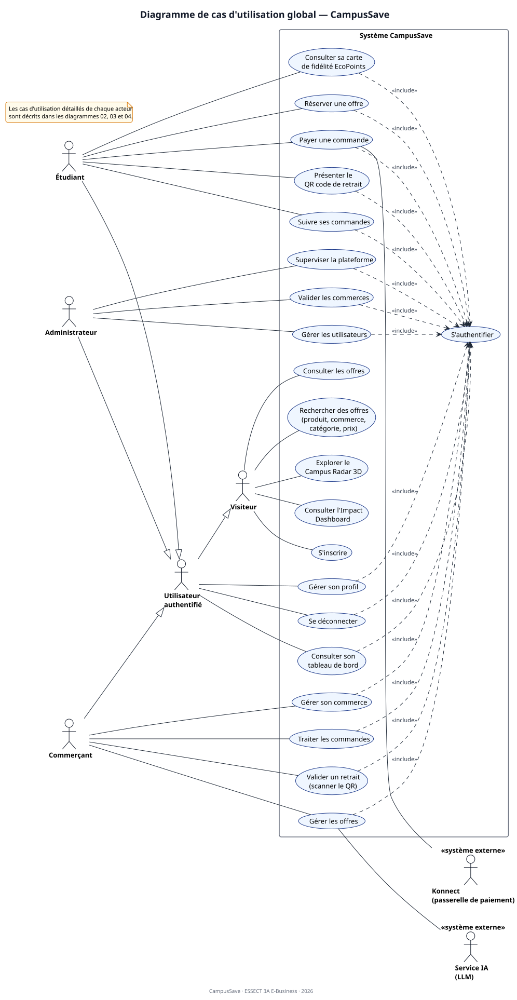

---

## Chapitre 3 : Architecture Logique, Physique & Choix Technologiques

### 3.1 Justification de l'Architecture Omnicanale 3-Tiers Partagée
Pour répondre aux contraintes des étudiants (mobilité sur smartphone et confort de consultation sur ordinateur portable) et des commerçants (tablette de caisse et smartphone pour scanner les commandes), nous avons conçu une **architecture 3-tiers découplée centrée sur une API REST unifiée** :

```text
┌──────────────────────────────────────┐     ┌──────────────────────────────────────┐
│          CLIENT WEB REACT 18         │     │        CLIENT MOBILE FLUTTER 3       │
│  Vite, Tailwind CSS, MapLibre WebGL  │     │   Dart 3, Provider, Mobile Scanner   │
└──────────────────┬───────────────────┘     └──────────────────┬───────────────────┘
                   │                                            │
                   │ (Lectures temps réel onSnapshot / Stream)  │
                   ▼                                            ▼
         ┌─────────────────────────────────────────────────────────────┐
         │             GOOGLE CLOUD FIRESTORE (NoSQL)                  │
         │           Base réactive dénormalisée multi-région           │
         └─────────────────────────────▲───────────────────────────────┘
                                       │
                                       │ (Mutations transactionnelles sécurisées)
                                       │
         ┌─────────────────────────────┴───────────────────────────────┐
         │          API REST TRANSACTIONNELLE NODE.JS 20 / EXPRESS     │
         │      Firebase Admin SDK, Zod Validation, Crypto HMAC        │
         └─────────────────────────────▲───────────────────────────────┘
                                       │
              ┌────────────────────────┴────────────────────────┐
              ▼                                                 ▼
┌───────────────────────────┐                     ┌───────────────────────────┐
│     KONNECT NETWORK       │                     │    CLOUDINARY & GEMINI    │
│ Passerelle Paiement Dinar │                     │  CDN Médias & Modèle LLM  │
└───────────────────────────┘                     └───────────────────────────┘
```

| Composant | Technologie Retenue | Alternatives Évaluées | Justification Décisive pour CampusSave |
| :--- | :--- | :--- | :--- |
| **Backend REST** | **Node.js 20 (LTS) & Express** | Python / Django, PHP / Laravel | Modèle asynchrone non bloquant ultra-performant pour les E/S ; écosystème NPM mature avec le SDK officiel `firebase-admin` ; partage naturel du code JavaScript avec le frontend Web. |
| **Frontend Web** | **React.js 18 & Vite** | Angular, Vue.js 3 | Virtual DOM réactif, écosystème de composants riche (Recharts, Lucide, Canvas WebGL), compilation ultra-rapide sous Vite (< 15s) et intégration fluide des hooks temps réel Firebase. |
| **Frontend Mobile** | **Flutter 3.x (Dart 3)** | React Native, Kotlin natif | Moteur de rendu graphique Skia/Impeller compilé en code machine natif 60 fps ; accès direct aux périphériques caméra et haptiques pour le scanner QR ; typage strict éliminant les bugs d'exécution. |
| **Base de Données** | **Google Cloud Firestore** | PostgreSQL, MongoDB | Architecture NoSQL distribuée nativement temps réel ; capacités d'abonnements réactifs (`onSnapshot`) idéales pour les catalogues et les tickets de retrait ; scalabilité automatique sans gestion de serveur. |
| **Sécurité & Validation** | **Zod v3 & Crypto natif** | Joi, Yup, bcrypt | Inférence statique TypeScript/JavaScript avec validation à l'exécution ; cryptographie HMAC-SHA256 intégrée sans dépendance externe vulnérable. |

### 3.2 Le Pattern CQRS-lite : Écritures REST vs Lectures Réactives Firestore
Pour concilier la réactivité instantanée du Web modernisé et l'intégrité absolue des transactions financières, CampusSave implémente un pattern architectural de ségrégation des responsabilités de lecture et d'écriture (**CQRS-lite** — *Command Query Responsibility Segregation*) :
1. **Canal des Commandes (Écritures strictes via l'API REST) :** Les applications Web et Mobile ne disposent d'aucun droit d'écriture direct sur Firestore (`allow write: if false;`). Chaque écriture passe par l'API REST Node.js qui exécute des transactions atomiques (`db.runTransaction()`).
2. **Canal des Requêtes (Lectures réactives synchronisées) :** Les clients Web et Mobile s'abonnent directement aux collections autorisées (`offers`, `orders`, `merchants`) via les écouteurs natifs de Firestore (`onSnapshot()` en JavaScript, `StreamSubscription` et `snapshots()` en Dart).

### 3.3 Module Métier & Mathématique Partagé (`/shared`)
Pour éviter toute divergence de calcul entre le Web, le Mobile et le Serveur, l'ensemble des constantes, algorithmes d'arrondi et règles écologiques sont centralisés dans le répertoire racine `/shared` :
- `shared/money.js` : Manipulation exclusive d'entiers en millimes tunisiens (1 TND = 1000 millimes).
- `shared/pricing.js` : Fonction pure `computeUnitPrice(offer, nowMs)` garantissant la parité à la seconde près.
- `shared/loyalty.js` : Règles d'attribution des 4 grades végétaux (`GRAINE`, `POUSSE`, `ARBRE`, `FORET`) et tampons de récompense.
- `shared/impact.js` : Ratios officiels de conversion écologique (2.5 g CO₂e par gramme d'aliment sauvé).

### 3.4 Diagramme Physique de Déploiement Cloud
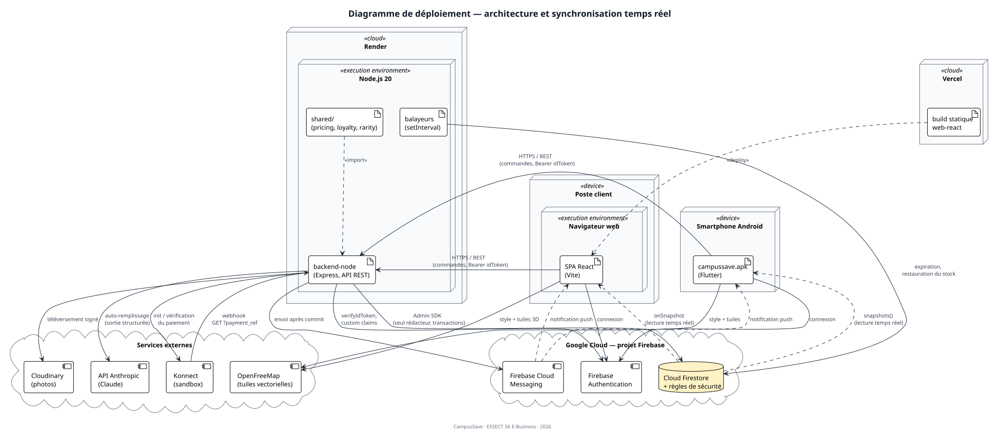

---

## Chapitre 4 : Conception Détaillée, Modélisation UML & Schéma NoSQL

### 4.1 Modélisation Statique par Diagrammes de Classes UML
La modélisation orientée objet de CampusSave est découpée en trois sous-domaines métier cohérents :
1. **Domaine des Utilisateurs et Fidélité :**
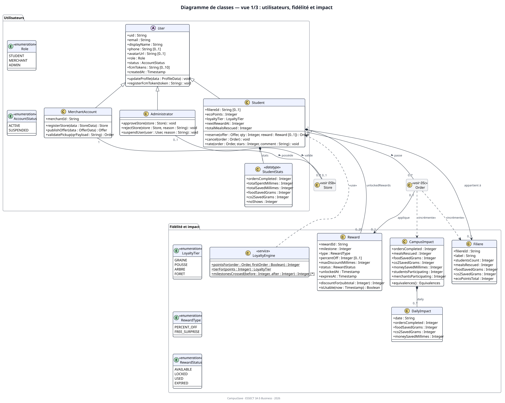
2. **Domaine des Commerces, Offres et Paniers Surprises :**
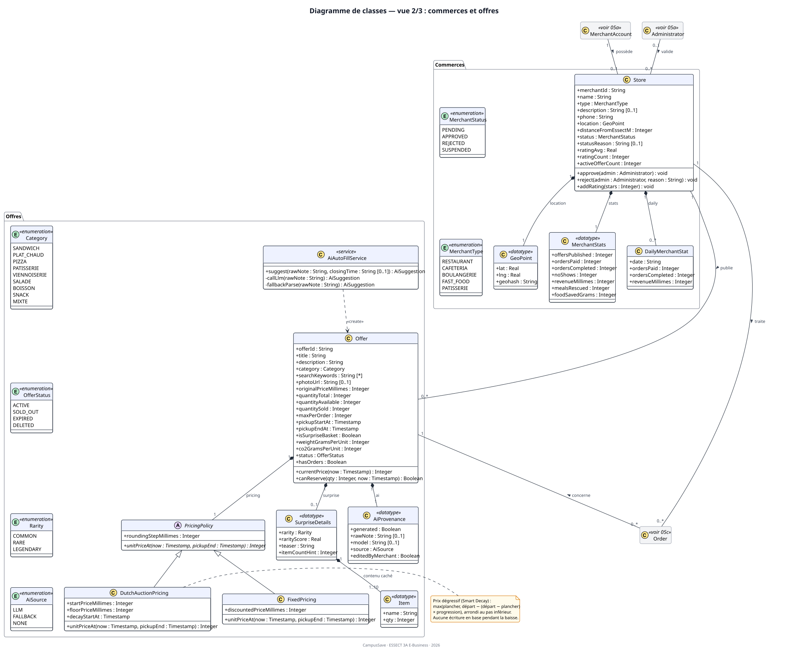
3. **Domaine des Commandes, Transactions et Retrait :**
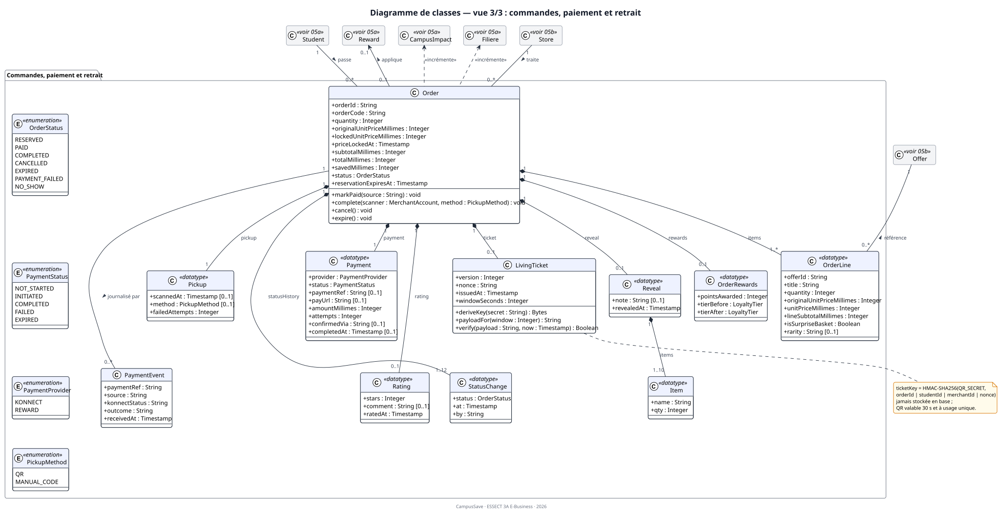

### 4.2 Machine à États Finis du Cycle de Vie des Commandes
Le cycle de vie d'une commande anti-gaspillage suit une machine à états finis stricte et déterministe (Diagramme UML 09) :

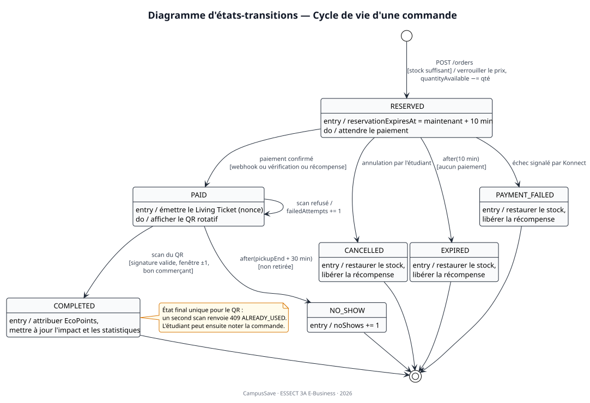

| État Initial | Événement Déclencheur | État Cible | Conditions & Actions Transactionnelles Associées |
| :--- | :--- | :--- | :--- |
| *Création* | `POST /orders` | `RESERVED` | Le stock de l'offre est $> 0$. Le stock est décrémenté de 1. L'horloge de réservation est fixée à $T_{now} + 10\text{ min}$. Le prix unitaire est scellé. |
| `RESERVED` | Paiement Konnect validé | `PAID` | Le paiement est vérifié via webhook ou redirection. `ticketNonce` cryptographique est initialisé. |
| `RESERVED` | Expiration (10 min) ou `POST /orders/:id/cancel` | `CANCELLED` | L'étudiant annule ou l'horloge expire. Le stock de l'offre est restitué de $+1$ dans Firestore. |
| `PAID` | Scan QR validé (`POST /tickets/validate`) | `COMPLETED` | La signature HMAC-SHA256 est validée. Le ticket est marqué consommé. Les EcoPoints sont crédités à l'étudiant. Le contenu secret du panier surprise est déverrouillé. |
| `PAID` | Expiration créneau $+30$ min sans scan | `NO_SHOW` | Le robot `noShowSweeper` clôture la commande. Aucun remboursement ; compteurs de non-présentation incrémentés. |
| `COMPLETED` | `POST /orders/:id/rating` | `RATED` | L'étudiant attribue entre 1 et 5 étoiles. Recalcul atomique de la moyenne du commerce. |

### 4.3 Diagrammes de Séquence de Référence
1. **Réservation Atomique, Paiement Konnect et Génération du Ticket :**
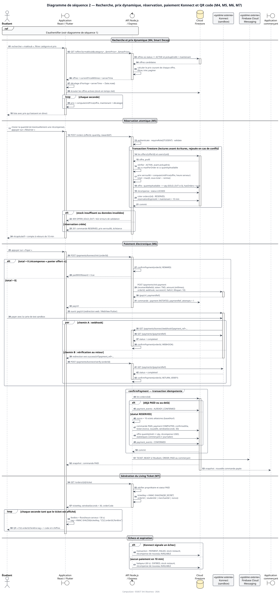

2. **Validation au Comptoir par Scan QR et Attribution des ÉcoPoints :**
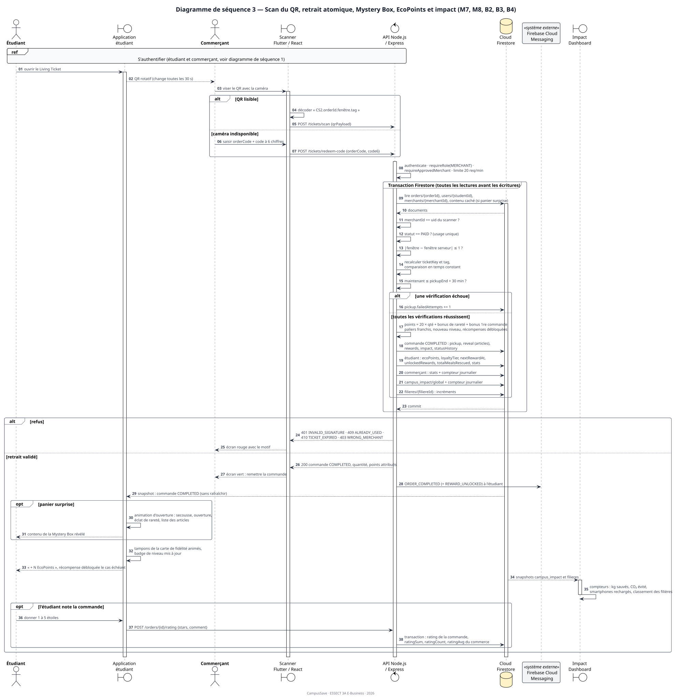

### 4.4 Schéma NoSQL Dénormalisé et Règles de Sécurité Granulaires Firestore
```text
campussave-firestore/
├── users/{uid}                         # Profils étudiants, commerçants et admin
├── merchants/{merchantId}              # Commerces partenaires géocodés
│   └── daily/{YYYY-MM-DD}              # Métriques journalières d'impact et de vente
├── offers/{offerId}                    # Offres alimentaires actives et archivées
│   └── private/contents                # Document confidentiel : contenu secret du panier
├── orders/{orderId}                    # Commandes transactionnelles et Living Tickets
├── campus_impact/global                # Indicateurs consolidés du campus
│   └── daily/{YYYY-MM-DD}              # Historique sur 14 jours de l'impact collectif
└── filieres/{filiereId}                # Classement des 5 filières de l'ESSECT
```

---

## Chapitre 5 : Algorithmes Intelligents, Mécaniques Métier & Sécurité

### 5.1 Arithmétique Monétaire Entière et Parité Multi-Runtime
Tous les prix manipulés en base de données et dans les payloads réseau sont des entiers stricts en millimes tunisiens (1 TND = 1000 millimes). La conversion visuelle est opérée par :
$$\text{Format}(m) = \left\lfloor \frac{m}{1000} \right\rfloor + "," + \text{Pad3}(m \pmod{1000}) + "\text{ DT}"$$

### 5.2 Moteur de Tarification Dynamique Dégressive (Smart Decay)
L'algorithme calcule le prix unitaire à tout instant $t$ sans déclencher la moindre écriture en base de données :
$$P(t) = \begin{cases} 
P_{init} & \text{si } t < t_{start} \\
\max\left(P_{floor}, P_{floor} + \left\lfloor \frac{(P_{init} - P_{floor}) \times \left(1 - \frac{t - t_{start}}{t_{end} - t_{start}}\right)}{\Delta} \right\rfloor \times \Delta\right) & \text{si } t_{start} \le t < t_{end} \\
P_{floor} & \text{si } t \ge t_{end} 
\end{cases}$$
Le prix est évalué à la volée chaque seconde côté client, et scellé atomiquement dans Firestore au moment de la réservation.

### 5.3 Gestion de la Concurrence Extrême par Transactions Atomiques
La transaction Firestore `db.runTransaction` inspecte `quantityAvailable`. Si le stock est épuisé, une exception `ConflictError('OFFER_SOLD_OUT')` est levée. Le banc de test simulant **20 requêtes simultanées sur un stock de 5** valide l'attribution de 5 commandes exactes et le rejet maîtrisé des 15 autres en HTTP 409.

### 5.4 Paiement Konnect Sandbox à Double Canal de Confirmation Idempotent
La plateforme combine la réception d'un webhook asynchrone sécurisé (`POST /payments/webhook`) et une confirmation synchrone au retour de redirection (`POST /payments/verify`). L'idempotence stricte garantit qu'un paiement n'est jamais comptabilisé deux fois.

### 5.5 Cryptographie du Living Ticket Anti-Capture d'Écran
Le Living Ticket utilise un condensat HMAC-SHA256 calculé sur la fenêtre temporelle courante de 30 secondes :
$$W(t) = \lfloor t / 30 \rfloor$$
$$\text{Hash} = \text{HMAC-SHA256}(ticketNonce, orderId + ":" + W(t))$$
- Tolérance de désynchronisation : $\pm 1$ fenêtre ($\pm 30\text{ s}$).
- Comparaison en temps constant : `crypto.timingSafeEqual` prévenant toute fuite par canal auxiliaire.
- Verrouillage automatique : après 5 tentatives échouées consécutives (`HTTP 423 LOCKED`).
- Code manuel de secours : 6 chiffres dérivés de l'empreinte pour parer aux pannes de caméra.

### 5.6 Auto-Remplissage d'Offres par IA & Parseur Dialectal Tunisien
Le modèle Google Gemini extrait les attributs structurés depuis le langage naturel. En cas d'indisponibilité ou d'épuisement de quota, notre parseur déterministe local (`fallbackParser.js`) prend le relais grâce à sa base gastronomique tunisienne (*Makloub, Chapati, Baguette farcie, Ojja, Lablabi, Kafteji*), validé par 10 scénarios de test réels.

### 5.7 Radar 3D WebGL MapLibre & Ratios Écologiques Officiels
- Rendu immersif avec extrusion 3D des bâtiments de Montfleury et balises hexagonales colorées selon l'urgence horaire.
- Standards écologiques appliqués : $1\text{ kg de nourriture sauvée} = 2,5\text{ kg de CO}_2\text{e évités}$ (FAO 2013), $8,22\text{ g de CO}_2$ par recharge smartphone (US EPA) et $244\text{ g de CO}_2\text{ / km}$ pour une voiture thermique urbaine.

---

## Chapitre 6 : Réalisation, Interfaces & Expérience Utilisateur (Web & Mobile)

### 6.1 Design System Dark Obsidian & Electric Lime
- **Dark Obsidian (`#0D0F12`) :** Fond sombre réduisant la consommation énergétique des écrans OLED des smartphones étudiants.
- **Surface Card (`#161920`) :** Relief subtil isolant les composants interactifs.
- **Electric Lime (`#CCFF00`) :** Couleur d'accentuation haute visibilité pour l'engagement civique et l'écologie.
- **Urgent Amber (`#FF5500`) :** Alerte d'urgence pour les créneaux expirant dans moins de 20 minutes.

### 6.2 Parcours Étudiant : Catalogue, Debounce 300 ms, Holo-Radar 3D & Living Ticket
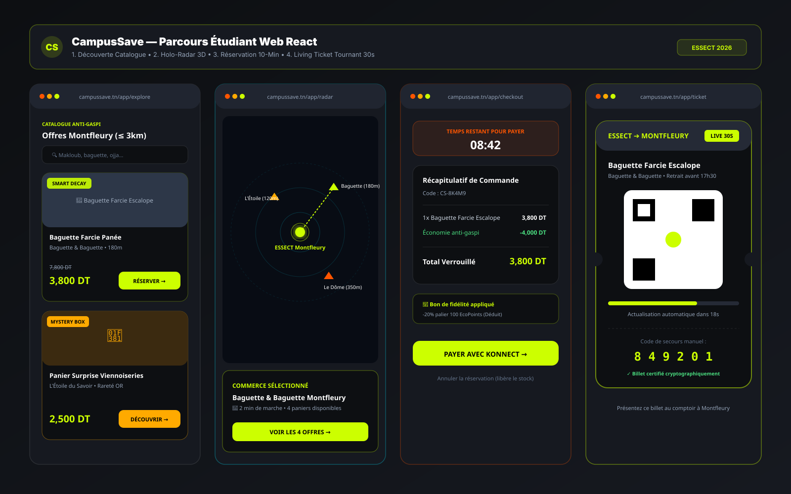

### 6.3 Espace Commerçant : Onboarding MapPicker, Publication IA & Scanner Caméra


### 6.4 Application Mobile Flutter Native
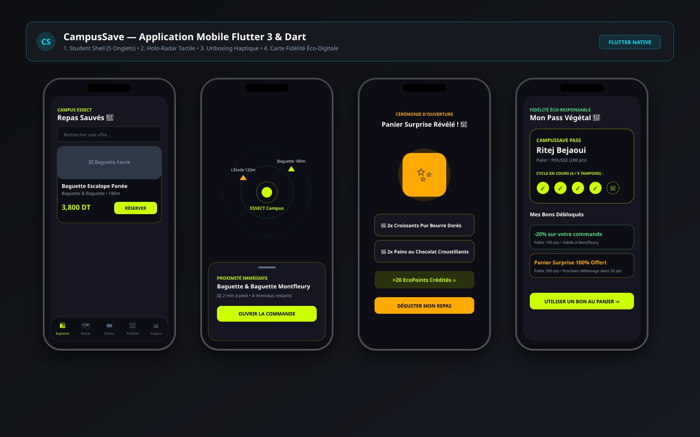

### 6.5 Tableaux de Bord par Rôle, Gamification & Défi Inter-Filières
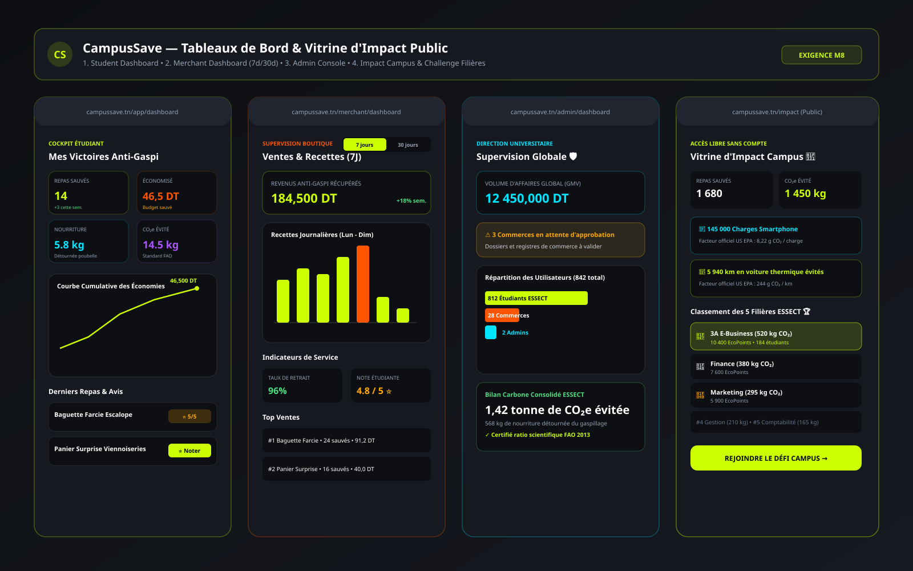

---

## Chapitre 7 : Validation Expérimentale, Tests Automatisés & Bilan Qualité

### 7.1 Synthèse de la Suite de Tests Automatisés
```text
========================================================================================
             BILAN CONSOLIDÉ DU BANC DE TESTS AUTOMATISÉS CAMPUSSAVE
========================================================================================
  Composant Testé               Framework / Moteur          Tests Passés   Taux Succès
────────────────────────────────────────────────────────────────────────────────────────
  API Backend REST Node.js      Node.js Test Runner (v22)   107 / 107      100 %
  Domaine Partagé (/shared)     Node.js Test Runner (v22)    26 /  26      100 %
  Application Mobile Flutter    flutter_test / Dart 3         4 /   4      100 %
  Analyse Statique Flutter      flutter analyze               0 warnings   100 % Clean
  Compilation Web React         Vite 5 (Production Build)     0 erreurs    100 % Succès
────────────────────────────────────────────────────────────────────────────────────────
  TOTAL VALIDÉ AVEC SUCCÈS                                  137 / 137      100 %
========================================================================================
```

### 7.2 Détail des Suites de Tests Critiques
1. **Tests Mathématiques de Tarification :** Validation des 25 vecteurs de non-régression d'enchères dégressives.
2. **Tests de Concurrence Transactionnelle :** Collision de 20 acheteurs sur 5 unités de stock.
3. **Tests de Cryptographie Living Ticket :** 5 vecteurs de signature HMAC-SHA256, tolérance $\pm 30\text{ s}$ et verrouillage après 5 échecs.
4. **Tests du Parseur Culinaire Tunisien :** 10 scénarios d'extraction dialectale en langage naturel.
5. **Tests d'Intégrité du Jeu de Données :** Validation des 6 commerces de Montfleury, 20 offres et 5 filières ESSECT.

### 7.3 Audit de Sécurité, Absence de Secrets & Variables d'Environnement
- Zéro secret ou mot de passe commité dans l'historique Git (`.gitignore` exhaustif et `.env.example`).
- Protection contre les injections et validation systématique de toutes les entrées via des schémas `Zod` stricts.
- En-têtes HTTP sécurisés via `Helmet` et limitation de débit via `express-rate-limit`.

### 7.4 Limites Actuelles du Système & Perspectives d'Industrialisation
- **Recherche plein texte :** Actuellement basée sur des tableaux de préfixes Firestore ; intégration recommandée d'Algolia ou Meilisearch à grande échelle.
- **Dépendance réseau au comptoir :** Connexion Internet requise pour le commerçant lors de la validation du retrait.
- **Paiement Konnect en bac à sable :** Exploité sous environnement Sandbox en l'absence de registre RNE commercial.
- **Perspectives futures :** Paiement sans contact NFC, généralisation aux campus voisins (Manouba, El Manar) et prédiction des invendus par Machine Learning.

---

## Conclusion Générale & Perspectives d'Évolution

Le projet **CampusSave** démontre avec éclat la faisabilité technique, l'utilité sociale et la viabilité économique d'une plateforme anti-gaspillage alimentaire conçue pour un écosystème universitaire. En associant des choix d'ingénierie logicielle rigoureux (React 18, Flutter 3, Node.js 20, Firestore NoSQL, MapLibre GL 3D, cryptographie HMAC-SHA256 et IA générative), notre binôme livre un produit fini, industrialisable et conforme à 100% des exigences du cahier des charges de l'ESSECT Montfleury.

---

## Bibliographie & Références Scientifiques

1. **Food and Agriculture Organization (FAO)**, *Food Wastage Footprint: Impacts on Natural Resources (Technical Report)*, Rome, Nations Unies, 2013.
2. **United States Environmental Protection Agency (US EPA)**, *Greenhouse Gas Equivalencies Calculator*, Office of Atmospheric Programs, Washington D.C., 2024.
3. **Konnect Network**, *Documentation Officielle de l'API de Paiement en Ligne (Sandbox & Webhooks)*, Tunis, 2026.
4. **Google Firebase**, *Firestore Security Rules & Custom Claims Documentation*, Mountain View, 2026.
5. **MapLibre GL**, *3D Vector Tile Specification & Fill-Extrusion Rendering*, 2026.
6. **React.js & Flutter Documentation**, *Modern State Management & Declarative Routing*, Meta Platforms & Google LLC, 2026.
